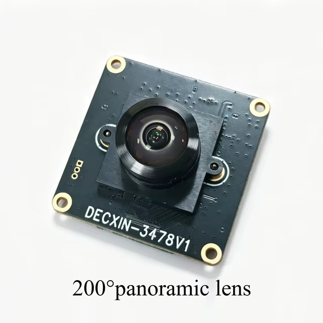

# AR0234 / DECXIN-3478V1

Документация цветной камеры AR0234 с объективом **200°**: устройство модуля,
распиновка, исходные материалы и запуск на SBC и микроконтроллерах. Основная целевая
плата — **Radxa Dragon Q6A**. Рабочий захват на ней пока не подтверждён.

## Камера

| Параметр | Имеющиеся сведения |
| --- | --- |
| Выбранный вариант | Цветная AR0234, объектив 200° |
| Модуль на изображениях продавца | DECXIN-3478V1; физическую ревизию нужно сверить с маркировкой экземпляра |
| Сенсор | Семейство onsemi AR0234CS, global shutter, 1920 × 1200, пиксель 3 мкм |
| Интерфейс модуля | Заявлены четыре линии MIPI CSI-2, FPC 22 контакта с шагом 0,5 мм |
| Внешний запуск | На J2 обозначены STRB, TRG, GND; электрические уровни и временные требования не установлены |
| Проверка работы | Нет зафиксированного кадра, проверенного драйвера или схемы переходника для Q6A |



Изображения относятся к материалам продавца. Полный код установленного
сенсора, модель объектива и электрическая схема модуля не определены.
120 кадр/с — заявленная возможность сенсора и модуля; фактические режимы
зависят от числа линий, драйвера и приёмника SBC.

## Найти нужное

| Задача | Документ |
| --- | --- |
| Характеристики, объектив, поток данных | [Справочник модуля](docs/reference/module.md) |
| Подключение FPC и J2 | [Распиновка](docs/reference/pinout.md) |
| Драйверы и ограничения режимов | [Справочник драйверов](docs/reference/drivers.md) |
| Разобраться в документах onsemi | [Документация сенсора](docs/reference/manufacturer.md) |
| Подготовить запуск на Q6A | [Разработка подключения Q6A](target/sbc/radxa_dragon_q6a/README.md) |
| Оценить путь Raspberry Pi или Jetson | [Raspberry Pi](target/sbc/raspberry_pi/README.md), [NVIDIA Jetson](target/sbc/nvidia_jetson/README.md) |
| Найти все SBC и микроконтроллеры | [Целевые платформы](target/README.md) |
| Проверить исходные документы | [Оригиналы и происхождение](docs/vendor/README.md) |

[Каталог документации](docs/README.md) показывает статус каждого маршрута.
Готовых инструкций, проверенных на физическом экземпляре, пока нет.

## Работа с репозиторием

```sh
git clone git@github.com:pOmelchenko/camera_ar0234.git
cd camera_ar0234
```

```text
docs/
  reference/    характеристики, распиновка, драйверы
  vendor/       оригинальные файлы, происхождение и SHA-256
  development/  состояние разработки и критерии проверки
target/
  sbc/<board>/  подключение, код, патчи и результаты для SBC
  mcu/<board>/  подключение, код, патчи и результаты для микроконтроллера
```

После аппаратной проверки маршрут оформляется в `docs/guides/<kind>/<board>.md`
с точной конфигурацией, командами и проверяемым результатом. Настройка ОС
и общие интерфейсы SBC описываются в репозитории платы; соединение и драйвер
этой камеры — здесь. Скрипты и патчи добавляются вместе с реальной работой
под соответствующим SBC. Локальные сборки и зависимости исключены из Git.

Из `docs/vendor` целостность оригиналов проверяется на macOS командой
`shasum -a 256 -c SHA256SUMS`, на Linux — `sha256sum -c SHA256SUMS`.
